<picture>
  <source media="(prefers-color-scheme: dark)" srcset="docs/images/brand/wordmark-dark.svg">
  
</picture>

# younghwan91

**한국 주식 오픈소스 퀀트 인프라와 수치 최적화 시스템을 만듭니다.**

기계공학 박사(*수치 최적화*) · 낮에는 **두산로보틱스** ML · 인지 엔지니어로 일합니다.

**한국어** · [English](README.md) | [Homepage](https://younghwan91.github.io/) · [LinkedIn](https://www.linkedin.com/in/younghwan-chae/) · [Email](mailto:chyohw97@gmail.com) · [이력서 (PDF)](https://github.com/younghwan91/resume/releases/latest/download/resume_ko.pdf)

## 아키텍처 개요

  <picture>
    <source media="(prefers-color-scheme: dark)" srcset="docs/images/architecture-ko-dark.svg">
    
  </picture>

## 주요 오픈소스 프로젝트

| 저장소 | 분야 | 설명 |
|--------|------|------|
| [**fin-checkup**](https://github.com/younghwan91/fin-checkup) | 개인 재무 | 재무 건전성 점검 및 포트폴리오 진단 CLI/도구 |
| [**kiwoom-client**](https://github.com/younghwan91/kiwoom-client) | 한국 주식 | 키움증권 REST/WebSocket 시세 · 주문 API 파이썬 클라이언트 |
| [**sector-flow**](https://github.com/younghwan91/sector-flow) | 한국 주식 | KRX 섹터 순환 및 기관 · 외국인 수급 흐름 분석 |
| [**krx-quant-core**](https://github.com/younghwan91/krx-quant-core) | 한국 주식 | KRX 데이터 · 시그널 · 백테스트 공통 퀀트 코어 라이브러리 |
| [**quant-airflow**](https://github.com/younghwan91/quant-airflow) | 데이터 파이프라인 | Airflow + TimescaleDB 기반 한국 주식 시세 · 재무 데이터 적재 |
| [**swing-it**](https://github.com/younghwan91/swing-it) | 알파 검증 | 랜덤 널 대조군 · Purged CV · Deflated Sharpe 기반 KOSPI/KOSDAQ 알파 검증 |
| [**portfolio-research**](https://github.com/younghwan91/portfolio-research) | 미국 주식 | 워크포워드 검증(Deflated Sharpe, PBO) 기반 미국 주식 팩터 · 자산배분 엔진 |

전체 생태계 (클라이언트 · 리서치 · 도구)

- **한국:** [krx-news-client](https://github.com/younghwan91/krx-news-client) · [krx-fundamentals-client](https://github.com/younghwan91/krx-fundamentals-client) · [daytrade-it](https://github.com/younghwan91/daytrade-it) · [scalp-it](https://github.com/younghwan91/scalp-it) · [kiwoom-order-guard](https://github.com/younghwan91/kiwoom-order-guard)
- **미국 · 크립토:** [macro-sector-agent](https://github.com/younghwan91/macro-sector-agent) · [quantbox](https://github.com/younghwan91/quantbox) · [crypto-quant-insights](https://github.com/younghwan91/crypto-quant-insights)
- **리서치 · 도구:** [automated-stock-trading-systems](https://github.com/younghwan91/automated-stock-trading-systems) · [resume](https://github.com/younghwan91/resume)

## 기술 스택

- **언어:** Python, C/C++, SQL, LaTeX
- **ML · 최적화:** PyTorch, 수치 최적화, 센서 퓨전, 4D 레이더 · 컴퓨터 비전
- **데이터 · 인프라:** PostgreSQL / TimescaleDB, DuckDB, Apache Airflow, Docker, Linux

## 라이선스

[CC BY-NC-ND 4.0](LICENSE) 라이선스를 따르며, 개인 오픈소스 퀀트 프로젝트는 본업과 무관합니다.
