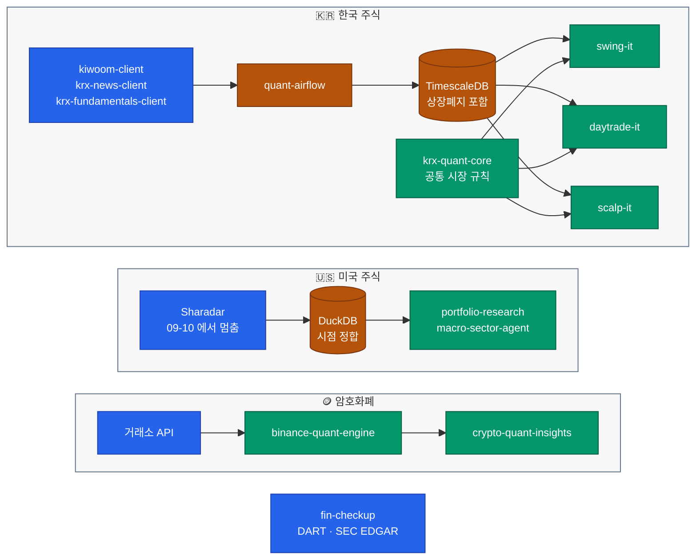

<h1 align="center">Younghwan Chae, Ph.D. · 채영환</h1>

  <b>기계공학 박사</b> &nbsp;—&nbsp; <b><i>수치 최적화</i></b> &nbsp;·&nbsp; <b>두산로보틱스</b> ML · 인지 엔지니어 
<b>학위 때부터 붙잡고 있는 건 결국 최적화 하나다.</b> 수치 최적화와 대리모델, 상태추정으로 시작해 지금은 3D 인지와 센서 퓨전, 양산 시스템에 그걸 쓴다. 아래 퀀트 레포들도 같은 규율로 돈다 — 전략 탐색은 최적화 문제이고, 탐색한 횟수만큼 값을 치른다.

<b>한국어</b> · <a href="README.md">English</a>

  
  
  

---

<h3></h3>

세 스택이 같은 뼈대를 쓴다. **수집하고, 저장하고, 그 위에서만 검증한다.** 한국 주식 쪽이 가장 두텁다 — 클라이언트 라이브러리들이 Airflow 하나를 거쳐 TimescaleDB 에 쌓이고, 공통 코어가 시장 규칙을 하나로 맞추고, 리서치·매매 레포는 거기서 읽는다. 탐색 자체도 청구서가 붙은 최적화로 다룬다 — 격자 스윕·Optuna TPE·CMA-ES 진화 엔진이 모든 config 를 실행 원장에 적고, Deflated Sharpe 와 PBO 가 시행 횟수만큼 청구하며, 표본 외 구간은 한 번만 연다.

파랑은 데이터 원천과 단독 도구, 앰버는 수집·저장, 초록은 리서치·엔진이다. `scalp-it` 과 `daytrade-it` 은 비공개다.

| 프로젝트 | 무엇인가 |
|---|---|
| **[kiwoom-client](https://github.com/younghwan91/kiwoom-client)**  | 키움증권 REST API 파이썬 래퍼 — 국내주식 엔드포인트 전부, 실시간 WebSocket, sync·async, 토큰 자동 갱신. 같은 API 를 도구로 내주는 **MCP 서버**가 들어 있고 실주문은 옵트인일 때만 · **`pip install kiwoom-client`**  |
| **[krx-news-client](https://github.com/younghwan91/krx-news-client)**  | 한국 주식 뉴스와 공시 — DART 공시와 토스증권 뉴스 — 를 한 스키마로 내주는 라이브러리. 기사 본문과 종목별 이력까지 · **`pip install krx-news-client`**  |
| **[krx-fundamentals-client](https://github.com/younghwan91/krx-fundamentals-client)**  | 국내 기업 펀더멘탈 — 재무제표·투자지표·배당·스크리닝 — 을 DART·KRX·네이버에서 모아 정규화한다. 상시 서버 없음 |
| **[quant-airflow](https://github.com/younghwan91/quant-airflow)**  | 두 주식 스택에 데이터를 대는 파이프라인 하나. 한국 시세·수급·실적·컨센서스·뉴스공시를 TimescaleDB 에 쌓되 **상장폐지 종목까지 되살려** 백테스트가 생존편향에 빠지지 않게 하고, 미국 Sharadar 재구축은 구독이 끝나 **멈춰 있다** |
| **[krx-quant-core](https://github.com/younghwan91/krx-quant-core)**  | 한국 주식 시스템들이 시장 규칙을 한 군데서 맞추는 공통 코어 — 호가단위, 비대칭 상·하한가, **시행일별** 증권거래세, 주문 가드, DART 공시 분류, 킬스위치 — 에 검증 통계와 리서치 층(격자 스윕·Optuna TPE·BIPOP CMA-ES)을 더했고, 실행 원장이 모든 시행을 적으며 **표본 외 구간을 하드 잠근다**. 전략은 없고 소비 레포 셋이 같은 버전을 핀한다 |
| **[fin-checkup](https://github.com/younghwan91/fin-checkup)**  | 유상증자·전환사채·감사의견·상장폐지 같은 위험 공시를 텔레그램으로 알리고, **DART 와 SEC EDGAR** 재무를 신호등으로 보여준다. **수치와 사실만 전하고 종목 추천은 하지 않는다** |
| **[swing-it](https://github.com/younghwan91/swing-it)**  | 코스피·코스닥 스윙 리서치, 두 축으로 — 섹터별 자금 흐름을 잰 값만 보여주는 **관측** 화면과, 알파 가설이 walk-forward·랜덤 음성대조·purged CV·Deflated Sharpe 를 **CI 가드레일로** 통과해야 하는 **심사** 트랙. **기각이 산출물이다** |
| **[portfolio-research](https://github.com/younghwan91/portfolio-research)**  | 미국주식 팩터 엔진 — 시점이 어긋나지 않고 생존편향을 보정한 데이터 위에서 전략 파라미터를 walk-forward 로 최적화하고, 탐색 비용은 **Deflated Sharpe 와 PBO** 가 청구한다. ETF 전술배분도 같은 관문을 지난다 · [writeup](https://younghwan91.github.io/portfolio-research/) |
| **[macro-sector-agent](https://github.com/younghwan91/macro-sector-agent)**  | 하향식 미국 산업 사이클 리서치 — "뭘 사야 하나"가 아니라 "**어느 산업이 잊혔나**"를 묻는다. LLM 판별기는 파이프라인의 좁은 허리에서만 증거를 따지고, **기계는 고르지 않는다 — 제외만 한다** |
| **[binance-quant-engine](https://github.com/younghwan91/binance-quant-engine)**  | 전략을 가리지 않는 바이낸스 USDT-M 선물 백테스트·실행 엔진 — 룩어헤드 0, 백테스트↔실거래 일체화, 청산은 거래소 측 알고 주문으로 미리 걸어 둔다. MCP 서버는 옵션 |
| **[crypto-quant-insights](https://github.com/younghwan91/crypto-quant-insights)**  | 실거래 선물 시스템을 검증하며 나온 차트 기반 연구 노트 — 폭락 스트레스 테스트, 승률 대 손익비, 표본 내·외 괴리, Kelly 레버리지 대 실제 배수, 백테스트 체결 대 실거래 체결. 전략은 비공개지만 발견은 공개다 |
| **[automated-stock-trading-systems](https://github.com/younghwan91/automated-stock-trading-systems)**  | Bensdorp 의 비상관 트레이딩 시스템 7개를 교육용으로 다시 구현한 백테스터 |

<h3></h3>

전략과 파라미터는 열지 않는다. 어떻게 굴러가는지, 어떤 규율을 지키는지만 적었다. **궁금하시면 따로 설명해 드린다.**

| 프로젝트 | 무엇인가 |
|---|---|
| **scalp-it**  | 국내 단타 프레임워크 — 장중 틱·호가 실시간 수집, **사전등록** 검증 프로그램(사전등록 해시, 표본 외 하드 잠금, 측정은 한 번), 그리고 지금은 **dry-run 으로만** 도는 주문 실행 루프 |
| **daytrade-it**  | 국내주식 뉴스 데이트레이딩 시스템 — 데몬이 토스 뉴스를 폴링하면 Claude 는 **사실만**(주인공인지, 새 소식인지, 방향) 뽑고 점수는 코드가 매기며, DART 중대공시 게이트는 캐시가 없거나 낡아도 진입을 거부한다. 지금은 종이매매로 돌고, 리플레이 엔진·원장·기록이 남는다 |
| **quantbox**  | 바이낸스 USDT-M 선물 브레이크아웃/모멘텀 시스템. 실거래로 운용했고 지금은 멈춰 뒀으며, 공개된 `binance-quant-engine` 은 여기서 전략만 걷어낸 것이다 |
| **crypto-pair-trading**  | 암호화폐 페어 트레이딩 프레임워크의 첫 판. `quantbox` 가 여기서 나왔다 |
| **resume-private**  | 이력서 비공개 원본 (LaTeX) |

<h3></h3>

  
  
  
  
  
  
  
  
  
  
  

