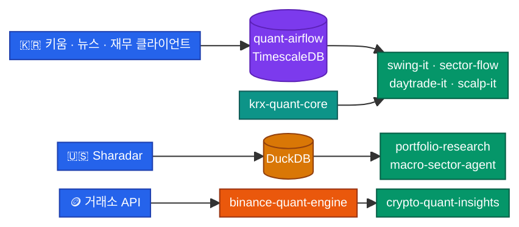

<h1 align="center">Younghwan Chae, Ph.D. · 채영환</h1>

  <b>한국 주식 오픈소스 퀀트 스택을 만든다.</b> 
  기계공학 박사(<i>수치 최적화</i>) · 낮에는 <b>두산로보틱스</b> ML · 인지 엔지니어.

<b>한국어</b> · <a href="README.md">English</a>

  
  
  

- **한국** — [kiwoom-client](https://github.com/younghwan91/kiwoom-client) · [krx-news-client](https://github.com/younghwan91/krx-news-client) · [krx-fundamentals-client](https://github.com/younghwan91/krx-fundamentals-client) · [quant-airflow](https://github.com/younghwan91/quant-airflow) · [krx-quant-core](https://github.com/younghwan91/krx-quant-core) · [swing-it](https://github.com/younghwan91/swing-it) · [sector-flow](https://github.com/younghwan91/sector-flow) · [daytrade-it](https://github.com/younghwan91/daytrade-it) · [scalp-it](https://github.com/younghwan91/scalp-it)
- **미국** — [portfolio-research](https://github.com/younghwan91/portfolio-research) · [macro-sector-agent](https://github.com/younghwan91/macro-sector-agent)
- **크립토** — [binance-quant-engine](https://github.com/younghwan91/binance-quant-engine) · [crypto-quant-insights](https://github.com/younghwan91/crypto-quant-insights)
- **도구** — [fin-checkup](https://github.com/younghwan91/fin-checkup) · [automated-stock-trading-systems](https://github.com/younghwan91/automated-stock-trading-systems)

## 라이선스

CC BY-NC-ND 4.0 — [LICENSE](LICENSE) 참고.
