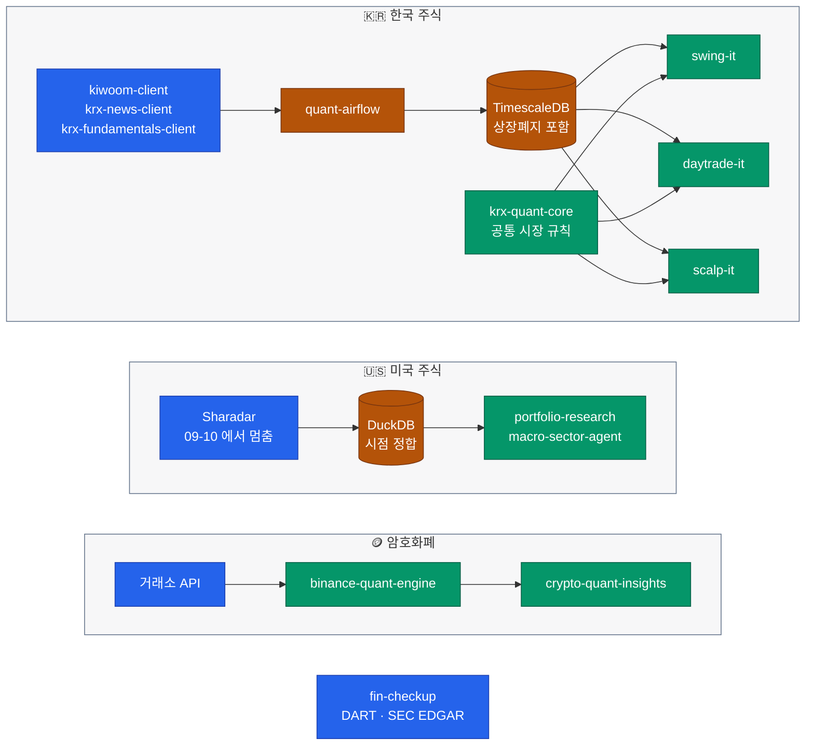

<h1 align="center">Younghwan Chae, Ph.D. · 채영환</h1>

  <b>기계공학 박사</b> &nbsp;—&nbsp; <b><i>수치 최적화</i></b> &nbsp;·&nbsp; <b>두산로보틱스</b> ML · 인지 엔지니어 
<b>학위 때부터 붙잡고 있는 건 결국 최적화 하나다.</b> 수치 최적화와 대리모델, 상태추정으로 시작해 지금은 3D 인지와 센서 퓨전, 양산 시스템에 그걸 쓴다.

<b>한국어</b> · <a href="README.md">English</a>

  
  
  

---

<h3></h3>

세 스택이 같은 뼈대를 쓴다. **수집하고, 저장하고, 그 위에서만 검증한다.** 한국 주식 쪽이 가장 두텁다 — 클라이언트 라이브러리들이 Airflow 하나를 거쳐 TimescaleDB 에 쌓이고, 공통 코어가 시장 규칙을 하나로 맞추고, 리서치·매매 레포는 거기서 읽는다.

파랑은 데이터 원천과 단독 도구, 앰버는 수집·저장, 초록은 리서치·엔진이다. `scalp-it` 과 `daytrade-it` 은 비공개다.

| 프로젝트 | 무엇인가 |
|---|---|
| **[kiwoom-client](https://github.com/younghwan91/kiwoom-client)**  | 키움증권 REST API 를 파이썬으로 감싼 라이브러리. 국내주식 엔드포인트를 빠짐없이 덮고 실시간 WebSocket 도 받는다. sync·async 양쪽, 토큰 자동 갱신. 같은 API 를 도구로 노출하는 **MCP 서버**도 들어 있어 AI 에이전트가 바로 쓴다 — 실주문은 옵트인일 때만 · **`pip install kiwoom-client`**  |
| **[krx-news-client](https://github.com/younghwan91/krx-news-client)**  | 한국 주식 뉴스와 공시를 한 스키마로 내주는 라이브러리 — DART 공시와 토스증권 뉴스, 기사 본문과 종목별 이력까지 · **`pip install krx-news-client`**  |
| **[krx-fundamentals-client](https://github.com/younghwan91/krx-fundamentals-client)**  | 국내 기업 펀더멘탈 — 재무제표·투자지표·배당·종목 스크리닝을 DART·KRX·네이버에서 모아 정규화한다. 상시 서버 없음 |
| **[quant-airflow](https://github.com/younghwan91/quant-airflow)**  | 두 주식 스택에 데이터를 대는 파이프라인 하나. 한국 쪽은 시세·수급·실적·컨센서스·상장주식수·뉴스공시를 TimescaleDB 에 쌓는다. **상장폐지 종목까지 되살려 담아** 이 데이터로 만든 백테스트는 생존편향에 빠지지 않고, 새벽에 전날 16:00 의 잠정치를 확정치로 다시 받는다. 뉴스 스트림에 대한 LLM 판정은 자기 원장에 남는다 — 그림자로만 채점하고 주문 근처엔 가지 않는다. 미국 쪽 Sharadar 스냅샷 재구축은 구독이 끝나 **멈춰 있고**, 스토어는 2026-09-10 빌드에서 고정이다 |
| **[krx-quant-core](https://github.com/younghwan91/krx-quant-core)**  | 한국 주식 시스템들이 시장 규칙을 한 군데서 맞추는 공통 코어 — 호가단위, 상·하한가(실제 일봉으로 대조하니 둘은 **대칭이 아니었다**), 세션 시각, 상수 하나 대신 **시행일별** 증권거래세 스케줄, 주문 가드, DART 중대공시 분류, 킬스위치, 검증 통계(Deflated Sharpe·purged walk-forward·매칭 대조군·선택편향 곡선). 0.7 에서 공용 데이터 층과 numba 커널, 그리고 실매매 코드를 그대로 돌려 지난 날을 재생하는 리플레이 엔진이 들어왔다. 실행 원장이 **표본 외 구간을 하드 잠가** 사전등록한 검정은 딱 한 번만 최종이다. 전략은 없다. 소비 레포 셋이 같은 버전을 핀하고, 모든 함수는 숫자가 똑같이 나오는 걸 대조한 뒤에야 라이브 트레이더가 갈아탔다 |
| **[fin-checkup](https://github.com/younghwan91/fin-checkup)**  | 관심 종목에 유상증자·전환사채·감사의견·상장폐지 같은 위험 공시가 뜨면 텔레그램으로 알리고, **DART 와 SEC EDGAR** 의 재무를 작년 값·업종 중앙값·동종업계 백분위와 나란히 신호등으로 보여준다. 수집·분류는 실데이터로 확인했지만 텔레그램 실발송은 아직이다. **수치와 사실만 전하고 종목 추천은 하지 않는다** |
| **[swing-it](https://github.com/younghwan91/swing-it)**  | 코스피·코스닥 스윙 리서치, 두 축을 일부러 떼어 뒀다. **관측**은 섹터별로 돈이 어디로 들고 났는지 보여주는 터미널 화면이고 잰 값만 보여준다. **심사**는 알파 가설을 개별 트레이드 분포로 판정한다 — walk-forward, 랜덤 음성대조, purged CV, Deflated Sharpe 를 **CI 가드레일로 강제**한다. 순수 노이즈도 "6폴드 중 5폴드 양수"를 절반 가까이 통과하므로, 기준은 전략이 자기 자신의 랜덤 버전을 이기는가다. **기각이 산출물이다**: 통과한 가설은 PEAD 하나뿐이다 |
| **[portfolio-research](https://github.com/younghwan91/portfolio-research)**  | 미국주식 팩터 엔진. 시점이 어긋나지 않고 생존편향을 보정한 데이터 위에서만 walk-forward 를 돌리고 **Deflated Sharpe 와 PBO** 로 거른다. ETF 전술배분도 같이 검증한다. **통과한 것만 싣지 않는다** — 사전등록한 TAA 설정은 전부 PBO 관문을 못 넘었고, 표제 숫자 하나는 스스로 철회했다 · [writeup](https://younghwan91.github.io/portfolio-research/) |
| **[macro-sector-agent](https://github.com/younghwan91/macro-sector-agent)**  | 하향식 미국 산업 사이클 리서치 — "지금 뭘 사야 하나"가 아니라 "**지금 어느 산업이 잊혔나**"를 묻는다. 사이클 저점인지 죽어가는 산업인지는 LLM 판별기가 증거를 놓고 따지되 파이프라인의 좁은 허리에만 두고, 그 위아래는 전부 결정론적이다. **기계는 고르지 않는다 — 제외만 한다** |
| **[binance-quant-engine](https://github.com/younghwan91/binance-quant-engine)**  | 전략을 가리지 않는 바이낸스 USDT-M 선물 백테스트·실행 엔진 — 룩어헤드 0, 백테스트↔실거래 일체화, 청산은 거래소 측 알고 주문으로 미리 걸어 둔다. MCP 서버는 옵션 |
| **[crypto-quant-insights](https://github.com/younghwan91/crypto-quant-insights)**  | 실거래 중인 선물 시스템을 검증하며 나온 차트 기반 연구 노트 — 시장 국면별 폭락 스트레스 테스트, 승률 대 손익비, 표본 내·표본 외 괴리, Kelly 레버리지와 실제 운용 배수의 차이, 백테스트 체결과 실거래 체결의 간극. 전략은 비공개지만 발견은 공개다 |
| **[automated-stock-trading-systems](https://github.com/younghwan91/automated-stock-trading-systems)**  | Bensdorp 의 비상관 트레이딩 시스템 7개를 교육용으로 다시 구현한 백테스터 |

<h3></h3>

전략과 파라미터는 열지 않는다. 어떻게 굴러가는지, 어떤 규율을 지키는지만 적었다. **궁금하시면 따로 설명해 드린다.**

| 프로젝트 | 무엇인가 |
|---|---|
| **scalp-it**  | 국내 단타 검증 프레임워크 + 장중 틱·호가 실시간 수집 + **실주문 루프**. 2026년 8월 말부터 감지기가 1주 실주문을 낸다 — 수량 하드캡, 가격 밴드, 일일 주문 한도, 연속손절 킬스위치를 건 채로. 틱은 소급 수집이 안 되니 놓친 날은 영원히 없다. **사전등록하고 딱 한 번만 잰다.** 사전등록 문서는 해시로 남기고 표본 외 구간은 하드 잠가서 최종 실행은 한 번이다. 사전등록 프로그램은 2026년 10월에 전진 판정 전부 기각으로 공식 종결했다 — 호가 흐름 스캘핑, 호가 시뮬레이터 위의 LightGBM 과 Double-DQN, 대기열을 아는 지정가 진입 엔진, 그리고 마지막엔 사후에 완벽히 고른 청산조차 이 유니버스에선 소매 왕복 비용을 못 넘는다는 오라클 측정까지 |
| **daytrade-it**  | 국내주식 뉴스 데이트레이딩 시스템. 데몬이 토스 뉴스를 폴링하면 Claude 는 **사실만** 뽑는다 — 이 회사가 기사의 주인공인지, 새 소식인지, 어느 방향인지. 매매 판단은 시키지 않고 점수는 코드가 매긴다. 그 종목에 중대 DART 공시가 걸려 있으면 진입을 거부하고, 그 캐시가 없거나 낡아도 거부한다 — 게이트가 조용히 통과시키는 일이 없게. **2026년 9월에 사흘간 무인 실주문을 냈고 멈췄다**: 뉴스 선정의 초과수익이 매칭 대조군 대비 몇 bp 인데 왕복 비용은 37bp 가까웠다. 그 뒤로는 종이매매로 돌려 판정 아카이브만 계속 쌓는다. 이어서 4단계 사전등록 파이프라인을 돌렸다 — 순위 자체는 진짜였지만(표본 외 IC 유지) 학습한 진입·청산 정책은 상수로 수렴했고 어느 단계도 노이즈 대조를 못 넘었다. **2026년 10월 판정: 이 방식의 뉴스 데이트레이딩엔 비용을 넘는 우위가 없다.** 레포에는 리플레이 엔진과 원장, 그리고 기록이 남는다 |
| **quantbox**  | 바이낸스 USDT-M 선물 브레이크아웃/모멘텀 시스템 — VR 압축 스퀴즈 + MA 클러스터 스퀴즈. 실거래로 운용했고 지금은 봇을 멈춰 뒀다. 공개된 `binance-quant-engine` 은 여기서 전략만 걷어낸 것이다 |
| **crypto-pair-trading**  | 암호화폐 페어 트레이딩 프레임워크의 첫 판. `quantbox` 가 여기서 나왔다 |
| **resume-private**  | 이력서 비공개 원본 (LaTeX) |

<h3></h3>

비공개 레포 둘이 같은 시장을 따로 재서 같은 벽에 닿았다. 두 레포의 종합 문서는 전략이 아니라 연구 기록이고, 한국 주식 스택이 지금까지 낸 것 중 가장 쓸모 있는 산출물이다.

- **벽은 비용이다.** 현물 왕복 비용은 약 41.5bp — 거래세 20bp, 수수료 3bp, 나머지는 스프레드. 두 팀이 잰 것 중 이 선을 유의하게 넘는 건 없었다. 오라클 청산도, 뉴스 순위도, 학습한 정책도.
- **모형이 약한 게 아니라 칸이 틀렸다.** 거래대금 상위 유니버스는 장중에 하루 약 28bp 를 잃고 야간에 그만큼을 되찾는다. 이 패턴은 십 년 넘게 이어졌다. 보유→종가 청산 전략은 매일 이 역풍을 먹고 출발하고, 손실의 절반 이상이 개장 첫 5분에 난다.
- **정보가 병목이 아니다.** 뉴스 순위는 *어느* 기사가 튈지를 안정적인 표본 외 IC 로 맞힌다. 돈이 안 될 뿐이다 — 경제 곡선은 어느 컷에서도 음수고, 지연을 0 으로 줄여도 한 자릿수 bp 가 보태진다.
- **통과한 유일한 알파는 운용되지 않는다.** PEAD 는 swing-it 의 관문을 전부 넘었지만 어느 크론도 그걸 돌리지 않는다. 그게 남은 과제다.

<h3></h3>

2026-10-07 부터 전부 **상시 호스트 한 대, `simnode`** 에서 돈다. 그 전 한 달은 `trader` 라는 두 번째 머신이 라이브 데몬과 스트리밍 리플리카를 맡았는데, 사전등록 프로그램이 닫히자 분리가 제값을 못 해 머신을 처분했다. 리플리카도 함께 사라졌다 — DB 의 두 번째 사본은 이제 매일 밤의 구글 드라이브 백업이다.

평일 하루(KST):

| 시각 | 도는 것 |
|---|---|
| **06:30** | `daily_finalize` — 전날의 잠정 일봉·수급·업종지수를 확정치로 다시 받는다 |
| **07:50** | CI 게이트 동기화 — 모든 레포가 GitHub 체크가 초록인 커밋까지만 fast-forward 하고 자기 크론을 설치한다 · 08:50 에 origin 보다 뒤처진 레포가 없는지 한 번 더 |
| **08:30–08:45** | 전일 아침 리포트 · DART 갱신 · 라이브 시스템별 개장 전 점검(읽기 전용) · `premarket_news_judgment` |
| **08:55** | 런처 둘이 뜬다 — scalp-it 감지기는 DB 에서 오늘 유니버스를 읽고, daytrade-it 데몬은 종이매매로 시작한다 |
| **09:00–15:20** | scalp-it 수집·매매 · 10분마다 DART · 틱 헬스체크 · 10:05 수집 캐치업과 `daily_news` · 11:35 Airflow 헬스체크 |
| **15:20–16:15** | scalp-it 종료, daytrade-it 은 동시호가까지 종이 청산을 관리 · 당일 리포트 · daytrade-it 전진 게이트 · 16:00 `daily_collection`·`daily_earnings`·틱 sanity · 16:05 `daily_news`·그림자 채점 · 오늘 틱을 드라이브로 |
| **16:55–19:00** | 수정주가 · 컨센서스 · 토스 종목별 뉴스 · 야간 리서치 스윕 · `swing-it` 일일 리포트 · 커버리지 · 전체 드라이브 백업 |

- **크론도 코드이고, 호스트는 빨간 CI 를 받지 않는다.** 레포마다 `deploy/crontab.simnode` 를 커밋한다. 설치기는 레포별 울타리 구역에 나눠 넣고 잘못된 줄이 하나라도 있으면 설치하지 않는다 — 깨진 체크아웃이 08:55 런처를 지우지 못하게. push 하면 원격 반영을 확인한 뒤 같은 설치가 돌고, 그 앞단에서 pre-push 훅이 레포의 `ci.yml` 을 로컬에서 먼저 돌린다.
- **시장 규칙은 하나다.** 호가단위 표, 가격제한폭, 주문 가드 판정, 비용 가정, 공시 분류가 레포마다 따로 있었고 이미 어긋나 있었다. 이제는 전부 `krx-quant-core` 에서 온다. 라이브 트레이더를 옮기는 건 돈을 옮기듯 했다 — 무작위 입력으로 옛 코드와 나란히 대조하고, 새 코드가 똑같이 나올 때까지 운영 체크아웃은 건드리지 않았다.
- **열린 포지션을 버려두는 킬스위치는 안전장치가 아니다.** `pair_STOP` 은 scalp-it 을 멈추고, `live_STOP` 은 daytrade-it 의 *진입*만 멈춘다 — 청산은 계속 돈다. 둘 다 매수 직전에 브로커에서 잔고를 조회해 이미 보유한 종목은 사지 않는다.
- **측정이 주문보다 앞선다.** 두 라이브 시스템은 호스트 이름을 확인해 여기 아닌 곳에서는 백테스트를 거부하고, 모든 백테스트는 실행 원장에 적히고, 표본 외 구간은 첫 번째로 보기 전에 잠긴다. 기각도 코드와 같은 정성으로 커밋한다.
- **라이브 루프는 전날 배치에 기댄다.** 유니버스, 시황, 전일 종가는 전부 전날 16:00 수집에서 읽는다. 그 조회가 실패하면 scalp-it 은 고정 쌍으로 폴백하고 daytrade-it 은 진입하지 않는다.
- **어느 쪽이 PRIMARY 인지는 코드가 아니라 상태였다.** `pg_is_in_recovery()` 가 답했고, 두 호스트 시절 그 답은 한 번 뒤집혔다. 그때 반대로 *꺼야* 했던 것 하나 — 내려간 DB 컨테이너를 되살리는 헬스 가드. 그대로 뒀으면 강등된 옛 PRIMARY 를 깨워 split-brain 을 만들었을 것이다.

<h3></h3>

  
  
  
  
  
  
  
  
  
  
  

