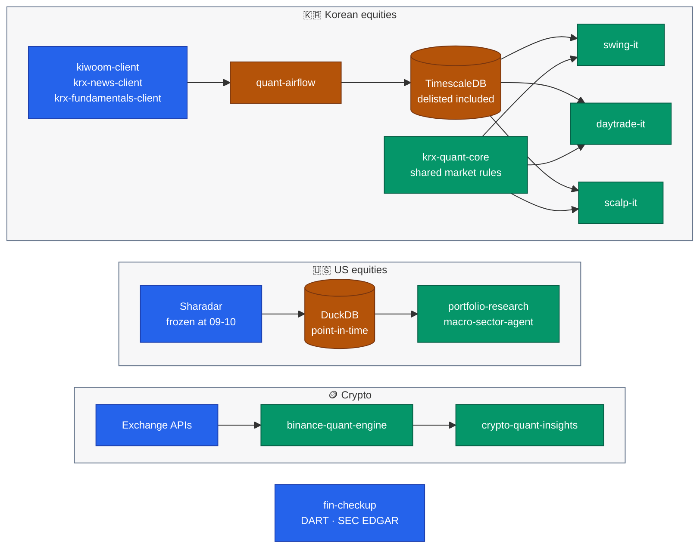

<h1 align="center">Younghwan Chae, Ph.D. · 채영환</h1>

  <b>PhD in Mechanical Engineering</b> &nbsp;—&nbsp; <b><i>Mathematical Optimization</i></b> &nbsp;·&nbsp; ML &amp; Perception Engineer <b>@ Doosan Robotics</b> 
  <b>Mathematical optimization is the through-line</b> — numerical optimization, surrogate modeling &amp; state estimation, carried from theory into 3D perception, sensor fusion, and production systems. The quant repos below run on the same discipline: strategy search is an optimization problem, and every trial is paid for.

<a href="README.ko.md">한국어</a> · <b>English</b>

  
  
  

---

<h3></h3>

Three stacks, one shape — **collect → store → research**. Korean equities get the most of it: client libraries feed one Airflow pipeline into TimescaleDB, a shared core fixes the market rules, and the research and trading repos read from there. The search itself is treated as optimization with a bill attached: grid sweeps, Optuna TPE and a CMA-ES evolutionary engine write every config to a run ledger, Deflated Sharpe and PBO charge for the number of trials, and the out-of-sample window opens once.

Blue — data sources &amp; standalone tools · amber — collection &amp; storage · green — research &amp; engines. `scalp-it` and `daytrade-it` are private.

| Project | What it is |
|---|---|
| **[kiwoom-client](https://github.com/younghwan91/kiwoom-client)**  | Kiwoom Securities REST API wrapper — every domestic-equity endpoint, real-time WebSocket, sync + async, auto token refresh. Ships an **MCP server** so AI agents call the same API as tools, real orders opt-in only · **`pip install kiwoom-client`**  |
| **[krx-news-client](https://github.com/younghwan91/krx-news-client)**  | Korean market news and disclosures — DART filings and Toss Securities — as one schema, article bodies and per-company history included · **`pip install krx-news-client`**  |
| **[krx-fundamentals-client](https://github.com/younghwan91/krx-fundamentals-client)**  | Korean corporate fundamentals — statements, valuation, dividends, screening — normalized from DART, KRX and Naver. No standing server |
| **[quant-airflow](https://github.com/younghwan91/quant-airflow)**  | The one pipeline behind both equity stacks: Korean prices, supply/demand, earnings, consensus, news and disclosures into TimescaleDB, with **delisted stocks backfilled** so downstream backtests aren't survivorship-biased. The US Sharadar rebuild into DuckDB is **paused** since the subscription lapsed |
| **[krx-quant-core](https://github.com/younghwan91/krx-quant-core)**  | Where the Korean-equity systems agree on market mechanics — tick sizes, asymmetric price limits, a **dated** transaction-tax schedule, order guards, DART disclosure classes, a kill switch — plus the validation statistics and a research layer (grid sweeps, Optuna TPE, BIPOP CMA-ES) whose run ledger records every trial and **hard-locks the out-of-sample window**. No strategies; all three consumers pin the same version |
| **[fin-checkup](https://github.com/younghwan91/fin-checkup)**  | Risk-disclosure alerts (rights offerings, CB issues, audit opinions, delistings) routed to Telegram, plus a traffic-light financial checkup over **DART &amp; SEC EDGAR**. **Facts and measurements only — never a recommendation** |
| **[swing-it](https://github.com/younghwan91/swing-it)**  | KOSPI/KOSDAQ swing research on two axes: an **observation** screen of where money went by sector, and a **judgment** track where alpha hypotheses face walk-forward, random null controls, purged CV and Deflated Sharpe **enforced as CI guardrails**. **The rejections are the product** |
| **[portfolio-research](https://github.com/younghwan91/portfolio-research)**  | US equity factor engine — strategy parameters walk-forward optimized on point-in-time, survivorship-bias-free data, with **Deflated Sharpe &amp; PBO** charging for the search; tactical ETF allocation goes through the same gate · [writeup](https://younghwan91.github.io/portfolio-research/) |
| **[macro-sector-agent](https://github.com/younghwan91/macro-sector-agent)**  | Top-down US sector-cycle research that asks **which industry has been forgotten**, not what to buy. An LLM judge argues from evidence at one narrow waist only; **the machine never picks — it only excludes** |
| **[binance-quant-engine](https://github.com/younghwan91/binance-quant-engine)**  | Strategy-agnostic Binance USDT-M futures backtest &amp; execution engine — zero lookahead, backtest↔live parity, exits placed as exchange-side algo orders, optional MCP server |
| **[crypto-quant-insights](https://github.com/younghwan91/crypto-quant-insights)**  | Chart-backed research notes from validating a live futures system — crash stress tests, win rate vs. reward-to-risk, in- vs. out-of-sample divergence, Kelly leverage vs. what's actually run, backtest vs. live fills. The strategy stays private; the findings don't |
| **[automated-stock-trading-systems](https://github.com/younghwan91/automated-stock-trading-systems)**  | Backtester for Bensdorp's seven non-correlated trading systems (educational reimplementation) |

<h3></h3>

Strategies and parameters stay closed. Only structure and discipline are written down. **Happy to walk through any of these on request.**

| Project | What it is |
|---|---|
| **scalp-it**  | Korean intraday framework — live tick/orderbook collection, a **pre-registered** validation program (hashed pre-registrations, hard-locked out-of-sample window, measured once) and an order execution loop that now runs **dry-run only** |
| **daytrade-it**  | Korean-equity news day-trading system — a daemon polls Toss news, Claude extracts **facts only** (subject, novelty, direction) and code does the scoring, behind a DART hard-severity gate that refuses entries when its cache is missing or stale. Runs in paper mode now; the replay engine, ledger and write-ups stay |
| **quantbox**  | Binance USDT-M futures breakout/momentum system, traded live and currently paused. `binance-quant-engine` is the public extract with the strategies removed |
| **crypto-pair-trading**  | First iteration of the crypto pair-trading framework — predecessor of `quantbox` |
| **resume-private**  | Private résumé source (LaTeX) |

<h3></h3>

  
  
  
  
  
  
  
  
  
  
  

