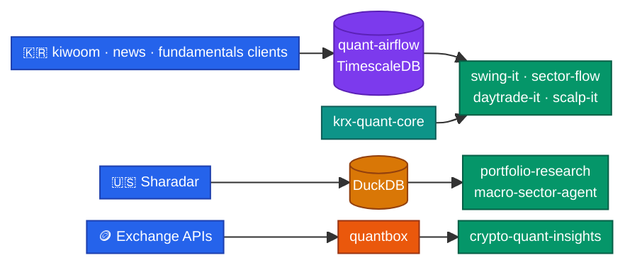

<h1 align="center">Younghwan Chae, Ph.D. · 채영환</h1>

  <b>Open-source quant infrastructure for Korean equities.</b> 
  PhD in mechanical engineering (<i>mathematical optimization</i>) · ML &amp; perception engineer <b>@ Doosan Robotics</b> by day.

<a href="README.ko.md">한국어</a> · <b>English</b>

  
  
  

- **Korea** — [kiwoom-client](https://github.com/younghwan91/kiwoom-client) · [krx-news-client](https://github.com/younghwan91/krx-news-client) · [krx-fundamentals-client](https://github.com/younghwan91/krx-fundamentals-client) · [quant-airflow](https://github.com/younghwan91/quant-airflow) · [krx-quant-core](https://github.com/younghwan91/krx-quant-core) · [swing-it](https://github.com/younghwan91/swing-it) · [sector-flow](https://github.com/younghwan91/sector-flow) · [daytrade-it](https://github.com/younghwan91/daytrade-it) · [scalp-it](https://github.com/younghwan91/scalp-it)
- **US** — [portfolio-research](https://github.com/younghwan91/portfolio-research) · [macro-sector-agent](https://github.com/younghwan91/macro-sector-agent)
- **Crypto** — [quantbox](https://github.com/younghwan91/quantbox) · [crypto-quant-insights](https://github.com/younghwan91/crypto-quant-insights)
- **Tools** — [fin-checkup](https://github.com/younghwan91/fin-checkup) · [automated-stock-trading-systems](https://github.com/younghwan91/automated-stock-trading-systems)
