<picture>
  <source media="(prefers-color-scheme: dark)" srcset="docs/images/brand/wordmark-dark.svg">
  
</picture>

# younghwan91

**Open-source quant infrastructure &amp; numerical optimization systems.**

Ph.D. in Mechanical Engineering (*mathematical optimization*) · ML &amp; perception engineer **@ Doosan Robotics** by day.

[한국어](README.ko.md) · **English** | [Homepage](https://younghwan91.github.io/) · [LinkedIn](https://www.linkedin.com/in/younghwan-chae/) · [Email](mailto:chyohw97@gmail.com) · [Résumé (PDF)](https://github.com/younghwan91/resume/releases/latest/download/resume_en.pdf)

## Architecture Overview

  <picture>
    <source media="(prefers-color-scheme: dark)" srcset="docs/images/architecture-en-dark.svg">
    
  </picture>

## Featured Open Source Work

| Repository | Domain | Description |
|------------|--------|-------------|
| [**fin-checkup**](https://github.com/younghwan91/fin-checkup) | Personal Finance | Financial checkup &amp; portfolio diagnostics CLI/toolkit |
| [**kiwoom-client**](https://github.com/younghwan91/kiwoom-client) | Korean Equities | Python client for Kiwoom Securities REST/WebSocket market &amp; order APIs |
| [**sector-flow**](https://github.com/younghwan91/sector-flow) | Korean Equities | Sector rotation &amp; institutional flow analysis across KRX markets |
| [**krx-quant-core**](https://github.com/younghwan91/krx-quant-core) | Korean Equities | Shared quantitative core library for KRX data, signals, and backtesting |
| [**quant-airflow**](https://github.com/younghwan91/quant-airflow) | Data Pipeline | Airflow + TimescaleDB orchestration for Korean equity market &amp; fundamental data |
| [**swing-it**](https://github.com/younghwan91/swing-it) | Alpha Validation | KOSPI/KOSDAQ alpha validation with random null controls, purged CV &amp; Deflated Sharpe |
| [**portfolio-research**](https://github.com/younghwan91/portfolio-research) | US Equities | US equity factor engine &amp; tactical asset allocation gated by walk-forward validation |

Full ecosystem (clients, research &amp; tooling)

- **Korea:** [krx-news-client](https://github.com/younghwan91/krx-news-client) · [krx-fundamentals-client](https://github.com/younghwan91/krx-fundamentals-client) · [daytrade-it](https://github.com/younghwan91/daytrade-it) · [scalp-it](https://github.com/younghwan91/scalp-it) · [kiwoom-order-guard](https://github.com/younghwan91/kiwoom-order-guard)
- **US &amp; Crypto:** [macro-sector-agent](https://github.com/younghwan91/macro-sector-agent) · [quantbox](https://github.com/younghwan91/quantbox) · [crypto-quant-insights](https://github.com/younghwan91/crypto-quant-insights)
- **Research &amp; Tools:** [automated-stock-trading-systems](https://github.com/younghwan91/automated-stock-trading-systems) · [resume](https://github.com/younghwan91/resume)

## Tech Stack

- **Languages:** Python, C/C++, SQL, LaTeX
- **ML &amp; Optimization:** PyTorch, numerical optimization, sensor fusion, 4D radar &amp; computer vision
- **Data &amp; Infra:** PostgreSQL / TimescaleDB, DuckDB, Apache Airflow, Docker, Linux

## License

[CC BY-NC-ND 4.0](LICENSE) · Independent open-source quant work is unrelated to my day job.
