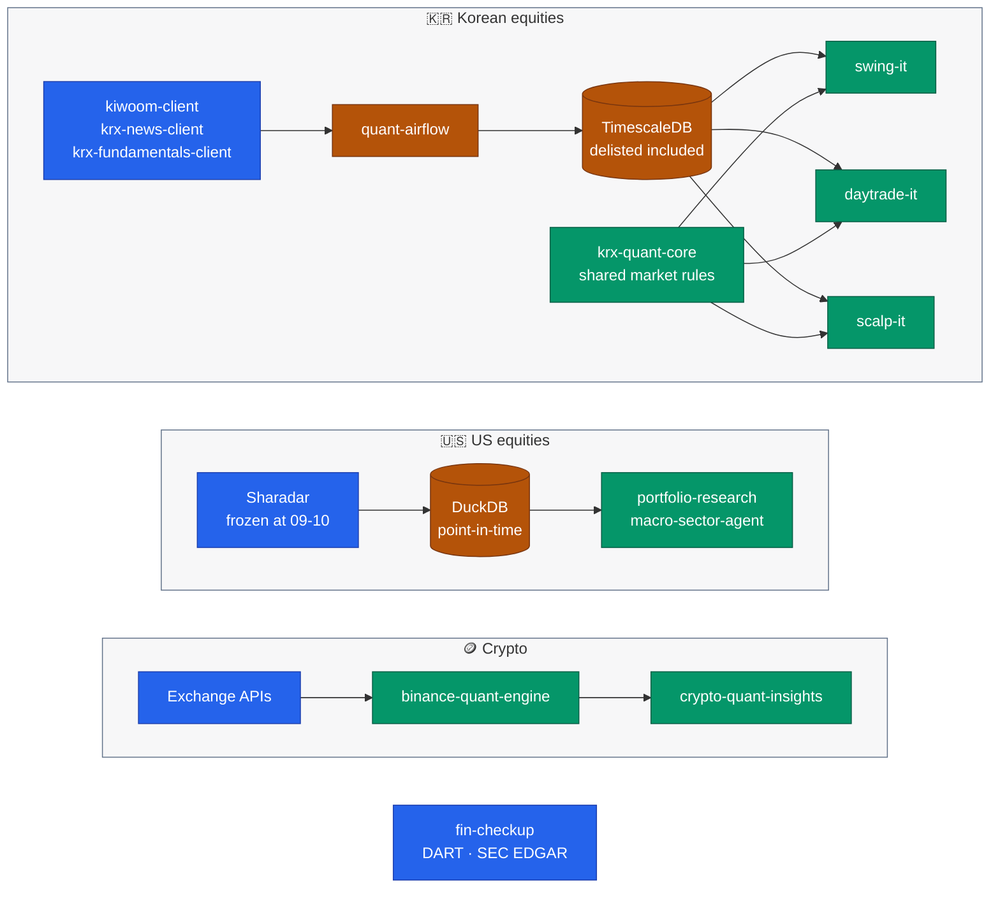

<h1 align="center">Younghwan Chae, Ph.D. · 채영환</h1>

  <b>PhD in Mechanical Engineering</b> &nbsp;—&nbsp; <b><i>Mathematical Optimization</i></b> &nbsp;·&nbsp; ML &amp; Perception Engineer <b>@ Doosan Robotics</b> 
  <b>Mathematical optimization is the through-line</b> — numerical optimization, surrogate modeling &amp; state estimation, carried from theory into 3D perception, sensor fusion, and production systems.

<a href="README.ko.md">한국어</a> · <b>English</b>

  
  
  

---

<h3></h3>

Three stacks, one shape — **collect → store → research**. Korean equities get the most of it: client libraries feed one Airflow pipeline into TimescaleDB, a shared core fixes the market rules, and the research and trading repos read from there.

Blue — data sources &amp; standalone tools · amber — collection &amp; storage · green — research &amp; engines. `scalp-it` and `daytrade-it` are private.

| Project | What it is |
|---|---|
| **[kiwoom-client](https://github.com/younghwan91/kiwoom-client)**  | Kiwoom Securities REST API wrapper — every domestic-equity endpoint, real-time WebSocket, sync + async, auto token refresh. Ships an **MCP server** so AI agents call the same API as tools, real orders opt-in only · **`pip install kiwoom-client`**  |
| **[krx-news-client](https://github.com/younghwan91/krx-news-client)**  | Korean market news &amp; disclosures as one schema — DART filings and Toss Securities, including article bodies and per-company history · **`pip install krx-news-client`**  |
| **[krx-fundamentals-client](https://github.com/younghwan91/krx-fundamentals-client)**  | Korean corporate fundamentals — financial statements, valuation, dividends, screening over DART + KRX + Naver. No standing server |
| **[quant-airflow](https://github.com/younghwan91/quant-airflow)**  | The one pipeline behind both equity stacks. Korea: prices, supply/demand, earnings, consensus, shares outstanding, news and disclosures into TimescaleDB, with **delisted-stock backfill** so downstream backtests aren't survivorship-biased, and a dawn re-collection that replaces the provisional 16:00 bars with final ones. LLM judgments over the news stream land in their own ledger — scored in shadow, never near an order. US: the Sharadar bulk rebuild into DuckDB, **paused** since the subscription lapsed; the store is frozen at the 2026-09-10 build |
| **[krx-quant-core](https://github.com/younghwan91/krx-quant-core)**  | The one place the Korean-equity systems agree on market mechanics — tick sizes, price limits (**not** symmetric, checked against real bars), session times, a **dated** transaction-tax schedule, order guards, DART hard-severity disclosure classification, a kill switch, and the validation statistics (Deflated Sharpe, purged walk-forward, matched-null controls, selection-bias curves). 0.7 added a shared data layer and numba kernels, plus a replay engine that runs the live trading code unchanged against recorded days. A run ledger **hard-locks the out-of-sample window** so a pre-registered test is final exactly once. No strategies. All three consumers pin the same version; every function was ported numerically identical and diffed before a live trader switched over |
| **[fin-checkup](https://github.com/younghwan91/fin-checkup)**  | Risk-disclosure alerts (rights offerings, CB issues, audit opinions, delistings) routed to Telegram, plus a traffic-light financial checkup over **DART &amp; SEC EDGAR** against last year, the sector median and the peer percentile. Collection and classification are verified on real data; the Telegram send itself is not yet. **Reports measurements and facts only — never a recommendation** |
| **[swing-it](https://github.com/younghwan91/swing-it)**  | KOSPI/KOSDAQ swing research on two axes kept apart. **Observation** — a terminal screen of where money went by sector, measurements only. **Judgment** — alpha hypotheses judged on the per-trade distribution with walk-forward, random null controls, purged CV and Deflated Sharpe, **enforced as CI guardrails**. Pure noise clears "5 of 6 folds positive" nearly half the time, so the test is whether a strategy beats its own randomized version. **The rejections are the product**: PEAD is the only hypothesis that has passed |
| **[portfolio-research](https://github.com/younghwan91/portfolio-research)**  | US equity factor engine — point-in-time, survivorship-bias-free, walk-forward gated by **Deflated Sharpe &amp; PBO**, plus tactical ETF allocation. **Ships the rejections too**: every pre-registered TAA config failed the PBO gate, and one headline number was retracted · [writeup](https://younghwan91.github.io/portfolio-research/) |
| **[macro-sector-agent](https://github.com/younghwan91/macro-sector-agent)**  | Top-down US sector-cycle research — it asks **which industry has been forgotten**, not what to buy. An LLM judge argues from evidence over whether a theme is a cycle trough or a structural death, only at that narrow waist; everything above and below is deterministic. **The machine never picks — it only excludes** |
| **[binance-quant-engine](https://github.com/younghwan91/binance-quant-engine)**  | Strategy-agnostic Binance USDT-M futures backtest &amp; execution engine — zero lookahead, backtest↔live parity, exits placed as exchange-side algo orders, optional MCP server |
| **[crypto-quant-insights](https://github.com/younghwan91/crypto-quant-insights)**  | Chart-backed research notes from validating that live futures system — crash stress tests across market regimes, win rate vs. reward-to-risk, in-sample vs. out-of-sample divergence, Kelly leverage vs. what's actually run, and the gap between a backtest fill and the live one. The strategy stays private; the findings don't |
| **[automated-stock-trading-systems](https://github.com/younghwan91/automated-stock-trading-systems)**  | Backtester for Bensdorp's seven non-correlated trading systems (educational reimplementation) |

<h3></h3>

Strategies and parameters stay closed. Only structure and discipline are written down. **Happy to walk through any of these on request.**

| Project | What it is |
|---|---|
| **scalp-it**  | Korean intraday validation framework + live tick/orderbook collection + **a live execution loop** — since late August 2026 its detector sends real one-share orders under a hard-capped size, a price band, a daily order cap and a consecutive-loss kill switch. Ticks can't be backfilled, so a missed day is gone for good. **Pre-register, measure once.** Pre-registrations are hashed and the out-of-sample window is hard-locked, so the final run happens once. The pre-registered program closed in October 2026 with every forward verdict rejected — orderbook-flow scalping, LightGBM and Double-DQN on an orderbook simulator, a queue-aware limit-entry engine, and finally an oracle test that showed even perfect hindsight exits don't clear retail round-trip cost in this universe |
| **daytrade-it**  | Korean-equity news day-trading system. A daemon polls Toss news; Claude extracts **facts only** — is the company the subject, is it new, which direction — never a trade call; scoring is code. Entries are refused while a hard-severity DART filing sits on the ticker, and also while that cache is missing or stale, so the gate can't pass trades silently. **Live, unattended, for three sessions in September 2026, then stopped**: the news-selection edge measured a few bp against a matched null with a round-trip cost near 37 bp. It has run in paper mode since, so the judgment archive keeps growing. A four-stage pre-registered pipeline followed — the ranking is real (out-of-sample IC held up), but the learned entry and exit policies collapsed to constants and no stage cleared its noise control. **Verdict, October 2026: news day-trading, done this way, has no edge over cost.** The repo keeps the replay engine, the ledger and the write-ups |
| **quantbox**  | Binance USDT-M futures breakout/momentum system — VR compression squeeze + MA cluster squeeze. Traded live; the bot is currently paused. `binance-quant-engine` is the public extract with the strategies removed |
| **crypto-pair-trading**  | First iteration of the crypto pair-trading framework — predecessor of `quantbox` |
| **resume-private**  | Private résumé source (LaTeX) |

<h3></h3>

  
  
  
  
  
  
  
  
  
  
  

